# [WACV 2027] FReSH-IR: Efficient All-in-One Weather Restoration using Spectral Harmonization

❄️🌧️ Download the model weights from [checkpoints](https://cidautes-my.sharepoint.com/:f:/g/personal/alvgar_cidaut_es/IgDU1k43ZjlXQabZkt5YUYZbATIteu8Fe_5qZ5U5VerTSuo?e=dYFDO4)

[Paula Garrido-Mellado](https://scholar.google.es/citations?user=YXE2fY4AAAAJ&hl=es), [Daniel Feijoo](https://scholar.google.es/citations?user=hqbPn4YAAAAJ&hl=es), [Yuning Cui](https://orcid.org/0000-0002-1279-5539), [Alvaro Garcia](https://scholar.google.es/citations?user=c6SJPnMAAAAJ&hl=es), [Marcos V. Conde](https://scholar.google.es/citations?user=NtB1kjYAAAAJ&hl=es) (CIDAUT AI, University of Wuerzburg and Technical University of Munich)

📄 [Paper (arXiv)](https://arxiv.org/abs/2609.02839)

**TLDR.** Adverse weather conditions such as rain, haze, and snow degrade image quality. FReSH-IR is a lightweight all-in-one image restoration method that processes high- and low-frequency information at multiple scales to restore images affected by different weather degradations, aiming for a strong balance between restoration quality and computational efficiency.

<details>
<summary><b>ABSTRACT</b></summary>

Adverse weather conditions such as rain, haze, and snow significantly degrade image quality, posing challenges for visual perception systems. Existing image restoration methods can be computationally expensive and often focus on specific degradations. We introduce **FReSH-IR (Frequency Reconstruction via Spectral Harmonization)**, an efficient all-in-one weather restoration approach that processes high- and low-frequency feature information within a hierarchical architecture. By combining frequency-aware processing with spatial feature integration, the method aims to preserve complementary spectral information while restoring weather-degraded images.

</details>


## Network Architecture

<p align="center">
  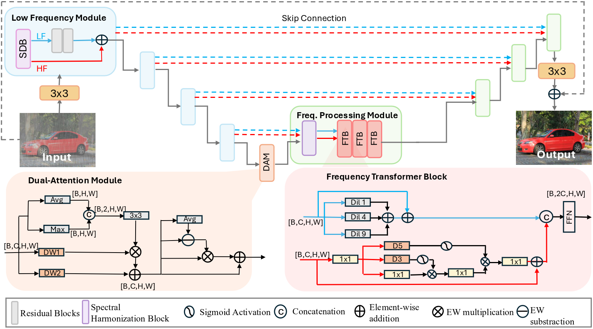
</p>

## Dependencies and Installation

Please update the versions below to match the environment used for the official experiments.

- Python: 3.12
- PyTorch: 2.4.1
- CUDA: 12.1
- Other required packages: see `requirements.txt`

```bash
# Clone this repository
git clone https://github.com/cidautai/FReSH-IR.git
cd FReSH-IR

# Create and activate a Python environment
python3 -m venv .venv
source .venv/bin/activate

# Install dependencies
pip install -r requirements.txt
```

## Datasets

The datasets used for training or evaluation are listed below. Please verify the final dataset list, splits, and official sources against the paper and the released configuration files before publication.

| Dataset | Degradation / purpose | Source |
|---|---|---|
| AllWeather | Multiple weather conditions | [Download](https://drive.google.com/file/d/1tfeBnjZX1wIhIFPl6HOzzOKOyo0GdGHl/view) |
| Snow100K | Snow | [Download](https://drive.google.com/drive/folders/1kLPWAev5f6OutKFALhxthuO1XCF5U1Yu) |
| RaindropData | Raindrops | [Download](https://drive.google.com/drive/folders/1e7R76s6vwUJxILOcAsthgDLPSnOrQ49K) |
| Outdoor | Rain and Haze | [Download](https://drive.google.com/file/d/1xgLG6656ahL7TfpeO_TplkMOQrfdxKbo/view) |
| CSD | Snow | [Download](https://drive.google.com/file/d/1smNrDvtPs89e0xk336Rt2-2KZffyX5H-/view)

Download the datasets from their official sources and arrange them according to the directory structure expected by the provided configuration files.

## Results

Please refer to the paper for the complete quantitative comparisons and evaluation protocols.

| Dataset | Method | PSNR-Y | SSIM | Params | GMACs |
|---|---|---:|---:|---:|---:|
| Outdoor Data | FReSH-IR (ours) | 30.84 | 0.90 | 8.32 | 3.46 |
| Snow100K-L | FReSH-IR (ours) | 30.75 | 0.89 | 8.32 | 3.46 |
| Raindrop A| FReSH-IR (ours) | 31.74 | 0.91 | 8.32 | 3.46 |

## Evaluation

Once the pretrained weights and dataset paths are configured, run the evaluation script below. Replace this example with the actual command supported by the repository.

```bash
python test.py -p <path_to_config>
```

## Inference

To restore a folder of images, use the inference interface provided by the repository. The following is an example only; update it to match the actual implementation.

```bash
python inference.py -i <folder_path>
```

The output directory and supported arguments depend on the released inference script.

## Gallery

<p align="center"> <strong> Outdoor Data </strong> </p>

| 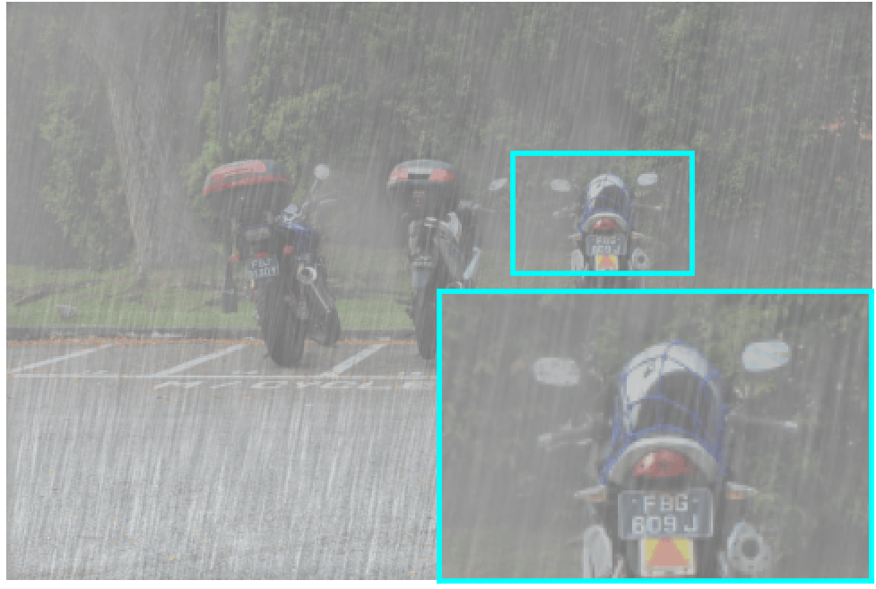 | 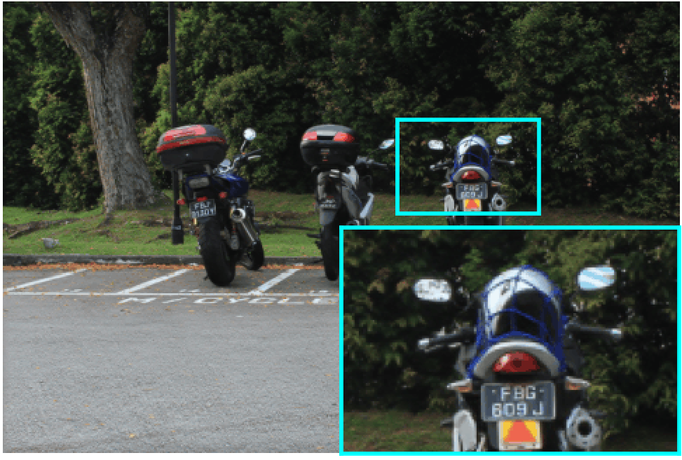 | 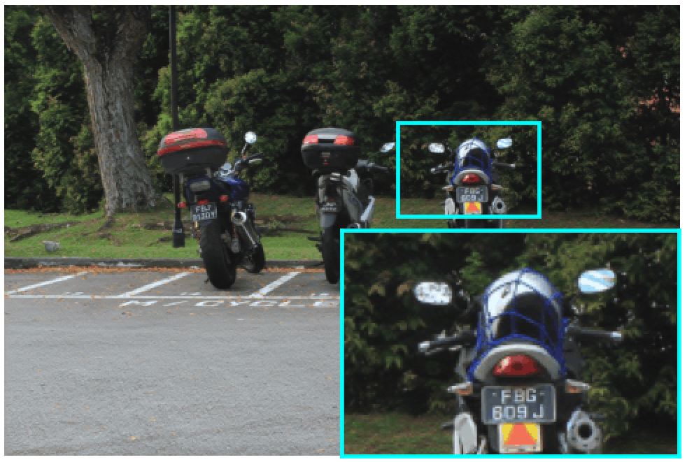 | 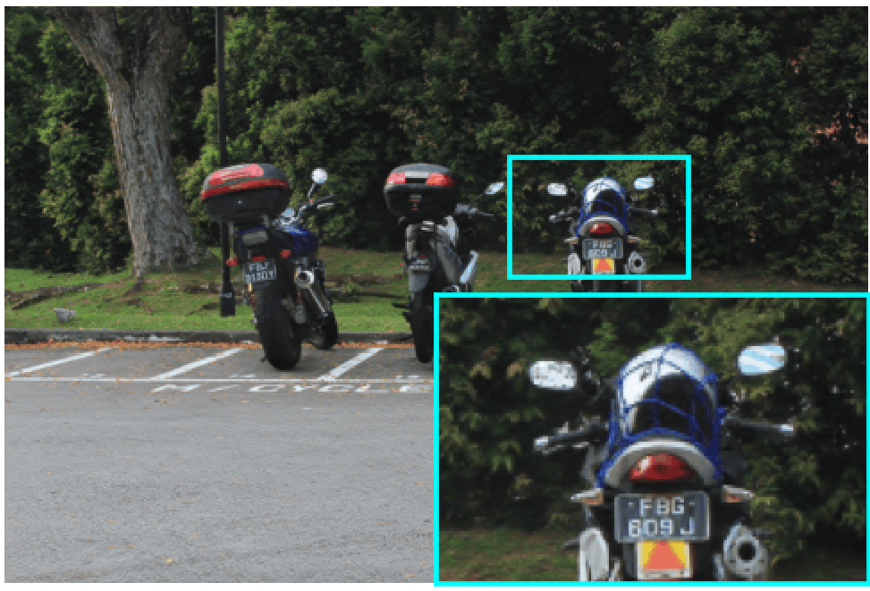 |  |
|:---:|:---:|:---:|:---:|:---:|
| Degraded | Histoformer | SSGformer | **FReSH-IR** (ours) | Ground Truth |

&nbsp;

<p align="center"> <strong> Snow100K-L </strong> </p>

| 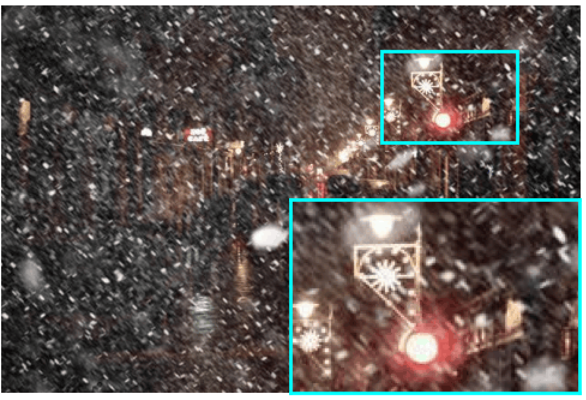 |  |  |  | 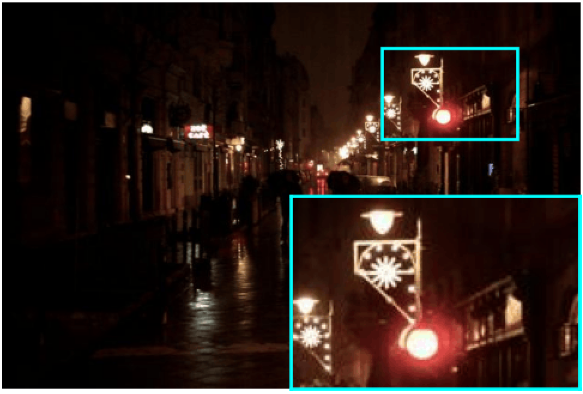 |
|:---:|:---:|:---:|:---:|:---:|
| Degraded | Histoformer | SSGformer | **FReSH-IR** (ours) | Ground Truth |

&nbsp;

<p align="center"> <strong> Raindrop A </strong> </p>

| 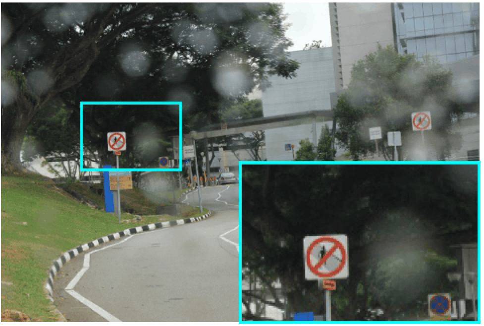 | 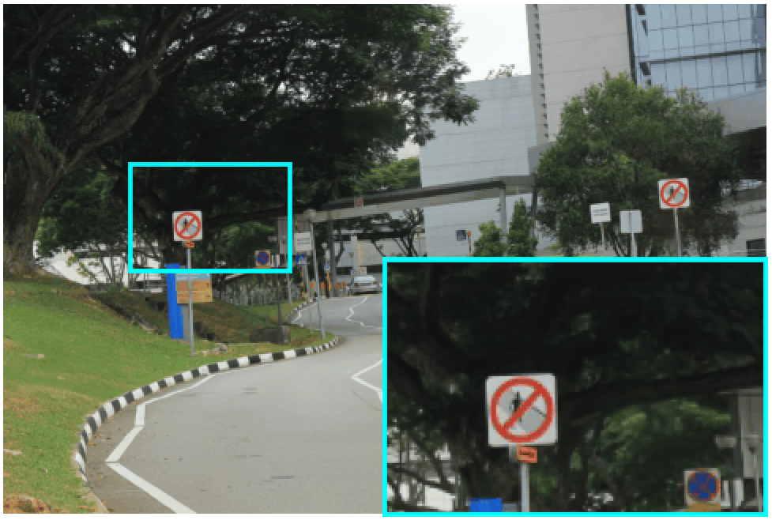 | 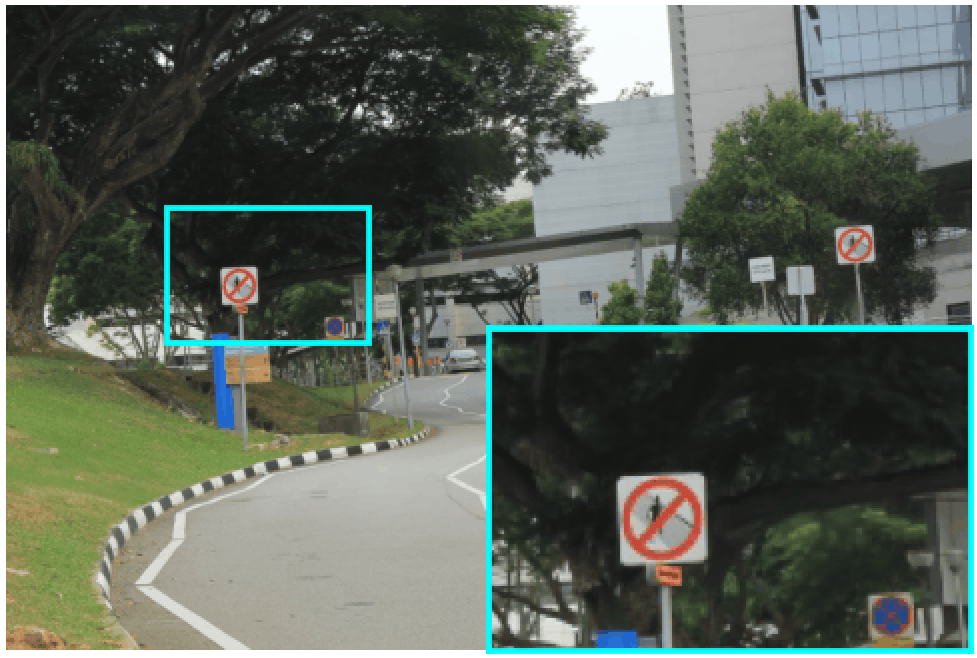 | 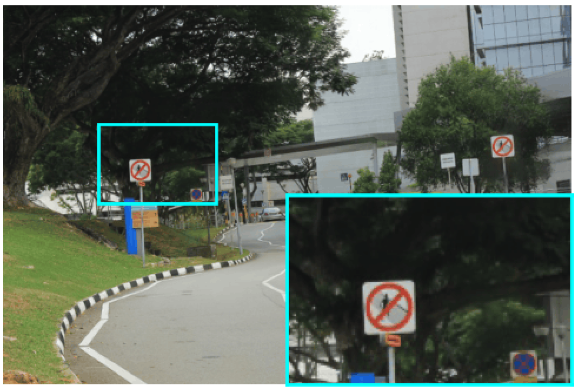 | 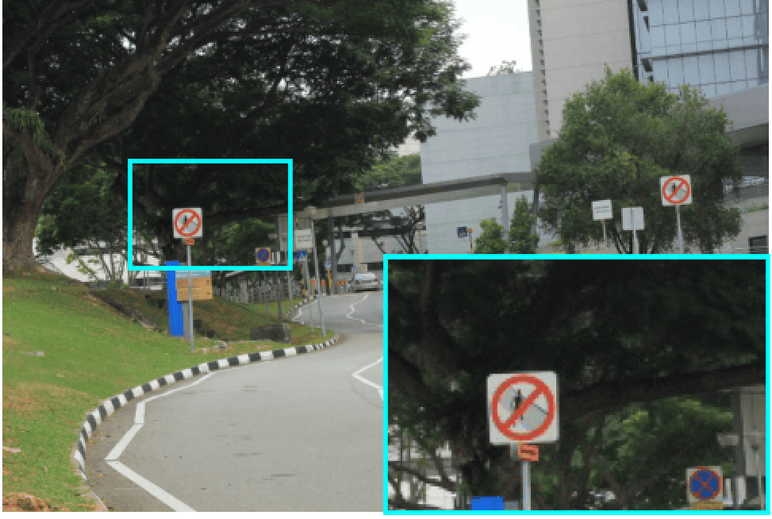 |
|:---:|:---:|:---:|:---:|:---:|
| Degraded | Histoformer | SSGformer | **FReSH-IR** (ours) | Ground Truth |

## Citation and Acknowledgement

This work has been accepted at the **IEEE/CVF Winter Conference on Applications of Computer Vision (WACV) 2027**.

If you find this work useful, please cite:

```bibtex
@article{garridomellado2026freshir,
  title   = {Efficient All-in-One Weather Restoration using Spectral Harmonization},
  author  = {Garrido-Mellado, Paula and
             Feijoo, Daniel and
             Cui, Yuning and
             Garcia, Alvaro and
             Conde, Marcos V.},
  journal = {arXiv preprint arXiv:2609.02839},
  year    = {2026}
}
```
